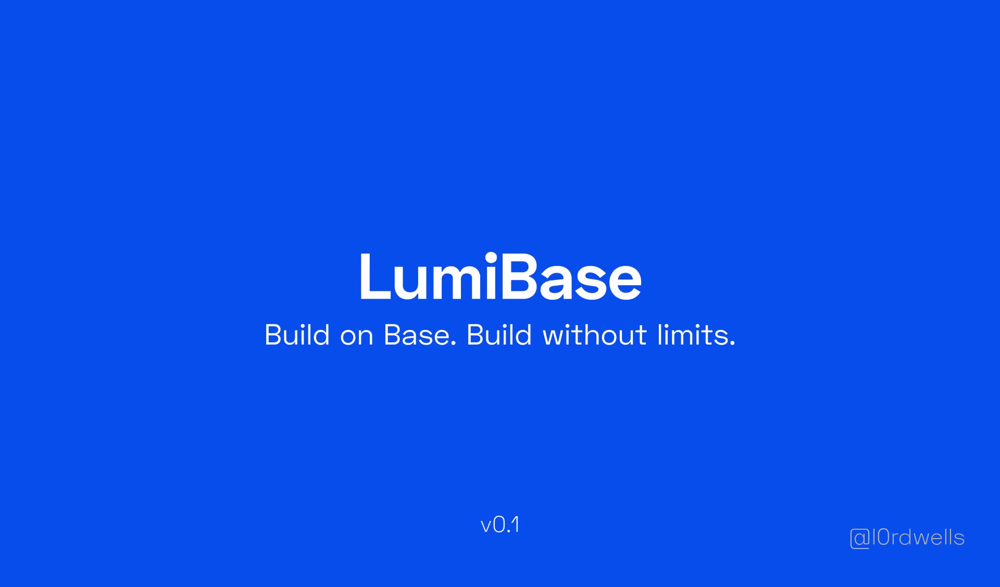
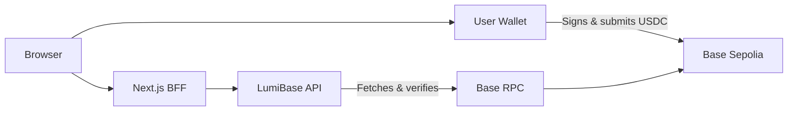

# LumiBase

[](./LICENSE)

**An open-source, language-agnostic developer toolkit for building on Base.**

LumiBase aims to make the essential infrastructure behind onchain applications easier to build, integrate, and verify.

We're starting with payments.

The first release provides the tools to create payment requests, accept USDC, and independently verify transactions on-chain, without trusting the client or taking custody of user funds.

**Payments are just the beginning.**

## Demo

[](https://x.com/l0rdWells/status/2125300922532471180)

*Watch the 60-second demo to see LumiBase create a payment, process a wallet transaction, and independently verify the result on Base Sepolia.*

## Project Status

**v0.1.0(Developer Preview)**

The first release introduces USDC payments on Base Sepolia, with independent on-chain verification, a developer API, webhooks, and a Next.js reference demo.

Base Mainnet is not yet supported.

This is an early foundation, not the final scope of LumiBase.

## The Goal

Building on Base should not mean reinventing the same infrastructure for every application.

Developers need reliable ways to handle common on-chain operations without having to independently solve every problem involving blockchain data, transaction verification, API security, and cross-language compatibility.

LumiBase is being built to provide that foundation.

The long-term goal is a modular, language-agnostic toolkit that developers can use to integrate essential Base infrastructure into their applications, regardless of their preferred programming language.

We're beginning with payments because handling money requires more than a client-side success message.

## Why LumiBase?

A typical payment integration can introduce several problems:

- **Client-side trust:** A frontend can claim that a payment succeeded without proving that the transaction actually did.
- **Blockchain complexity:** Developers must retrieve transactions, parse receipts and token events, handle confirmations, and account for failed or incomplete payments.
- **Repeated implementation:** Different applications end up rebuilding similar payment infrastructure.
- **Language lock-in:** A useful toolkit shouldn't require every developer to use the same programming language.

LumiBase addresses these problems by separating payment initiation from payment verification and making the underlying protocol independent of its TypeScript implementation.

## How It Works

LumiBase separates the user's wallet, the application backend, and the payment verification process.

1. **Create a payment request.** Your application requests a payment through the LumiBase API.
2. **Pay from a wallet.** The user sends USDC directly from their wallet to the specified recipient.
3. **Submit the transaction hash.** Your application provides the transaction hash as a reference, not as proof of payment.
4. **Verify independently.** LumiBase retrieves the transaction and receipt from its own RPC connection, validates the ERC-20 transfer, checks the payment details, and evaluates confirmation depth.
5. **Update payment status.** The API determines the authoritative payment outcome and can notify your application through webhooks.

The browser does not decide whether a payment succeeded. The server verifies the on-chain evidence independently.

## Core Principles

- **Independent verification:** Payment success is determined by blockchain evidence, not client-side claims.
- **Non-custodial:** Users send funds directly from their wallets. LumiBase does not hold user funds or private keys.
- **Language-agnostic:** Protocol definitions live in JSON specifications, allowing implementations in other languages to follow the same rules.
- **Modular:** Functionality is separated into packages that can evolve independently.
- **Developer-first:** Clear APIs, reusable components, documentation, and conformance fixtures make integration easier.
- **Secure by design:** Sensitive credentials remain server-side, and payment-critical operations are validated independently.

## Quick Start

### Requirements

- Node.js >= 20
- pnpm 9
- Docker

### Installation

```bash
# Clone the repository
git clone https://github.com/boycisco/lumibase.git
cd lumibase

# Start required services
docker compose up -d --wait

# Install dependencies
pnpm install

# Build packages
pnpm build

# Run the test suite
pnpm test
```

The test suite currently contains **556 tests**.

### Running the Reference Demo

The reference demo is a Next.js application located in `apps/demo/`. It demonstrates the payment lifecycle using Base Sepolia.

1. **Configure the demo environment.**

   Create `apps/demo/.env.local` and add the required variables. See [apps/demo/README.md](./apps/demo/README.md).

2. **Configure the Base Sepolia RPC.**

   Set `BASE_SEPOLIA_RPC` in the root `.env` file.

3. **Start the LumiBase API.**

   ```bash
   pnpm --filter @lumibase/api dev
   ```

4. **Start the reference demo in another terminal.**

   ```bash
   pnpm demo
   ```

5. Open `http://localhost:4000` and connect a wallet configured for Base Sepolia.

For additional setup details, see the [demo documentation](./apps/demo/README.md).

## Architecture



The frontend communicates with the Next.js Backend-for-Frontend (BFF), which securely forwards requests to the LumiBase API.

The BFF keeps application credentials server-side. The LumiBase API independently verifies transactions using its own blockchain connection.

The wallet remains under the user's control throughout the payment process.

## Packages

| Package | Description |
|---|---|
| `@lumibase/core` | Shared primitives, error handling, exact base-unit arithmetic, address validation, and chain safety gates. |
| `@lumibase/database` | PostgreSQL schema, database client, and persistence layer. |
| `@lumibase/network` | Viem-based blockchain access, ERC-20 transfer log parsing, and confirmation counting. |
| `@lumibase/payments` | Payment creation, retrieval, verification, and lifecycle management. |
| `@lumibase/api` | Fastify HTTP API, authentication, webhook registration, and delivery worker. |
| `@lumibase/conformance` | JSON Schema validators and fixtures for cross-language compatibility. |
| `apps/demo` | Next.js reference application demonstrating the payment integration. |

## Language Independence

TypeScript is the first implementation, not a requirement for using the protocol.

LumiBase specifications define the expected data structures, validation rules, and behavior independently of any programming language.

This makes it possible to build compatible implementations in languages such as Python and Rust without having to reproduce the original TypeScript internals.

The specifications and conformance fixtures are the foundation for that compatibility.

See the [Language Independence Guide](./specs/README.md).

## What's Next?

Payments are the first building block.

The broader direction for LumiBase is to expand into additional infrastructure that makes building on Base easier and more accessible to developers.

Future capabilities can build on the same principles:

- Modular integrations.
- Language-independent specifications.
- Independent verification.
- Reusable developer infrastructure.

The goal isn't to build another closed payment product. It's to create infrastructure developers can use, extend, and build upon.

## Documentation

- [Documentation Index](./docs/index.md)
- [Language Independence Guide](./specs/README.md)
- [Demo Setup](./apps/demo/README.md)

## Contributing

LumiBase is open source, and contributions are welcome.

If you're interested in improving the existing implementation, developing another language implementation, or extending the toolkit, start by exploring the specifications and package documentation.

Please open an issue to discuss significant changes before submitting a pull request.

## Security

Security issues should be reported privately rather than through public GitHub issues.

Please refer to [SECURITY.md](./SECURITY.md) for the vulnerability reporting process.

## License

LumiBase is licensed under the [Apache License 2.0](./LICENSE).